# GörevAkış: Arayüz tasarımı

AhsaTech için hazırlanan iş takip uygulamasının ekran tasarımları. Tasarım Figma'da çizildi. Bu klasörde aynı 12 ekranın HTML/CSS kodu ve ekran görüntüleri bulunur. Uygulama Flutter ile yazılacak; buradaki kod, Flutter ekranlarına geçerken ölçü, renk ve metinler için referanstır.

- **Figma dosyası:** https://www.figma.com/design/b5zCih6VsOk1hNCE2Mx6jN
- **Tıklanabilir prototip:** https://www.figma.com/proto/b5zCih6VsOk1hNCE2Mx6jN/GorevAkis?node-id=2-86&starting-point-node-id=2%3A86

## Nasıl açılır

`index.html` dosyasını tarayıcıda açın. 12 ekran yan yana, telefon boyutunda görünür. Tek bir ekranı açmak için `ekranlar/` içindeki dosyaya çift tıklamak yeterlidir. Herhangi bir kurulum gerekmez.

## Klasör yapısı

```
tasarim/
├── README.md
├── index.html            Tüm ekranları bir arada gösteren sayfa
├── gorevakis.css         Ortak renkler, yazı tipleri ve bileşen stilleri
├── ekranlar/             Her ekranın HTML kodu (390 × 844 px)
└── goruntuler/           Ekranların PNG görüntüleri
```

## Ekranlar

| | | |
|:-:|:-:|:-:|
| 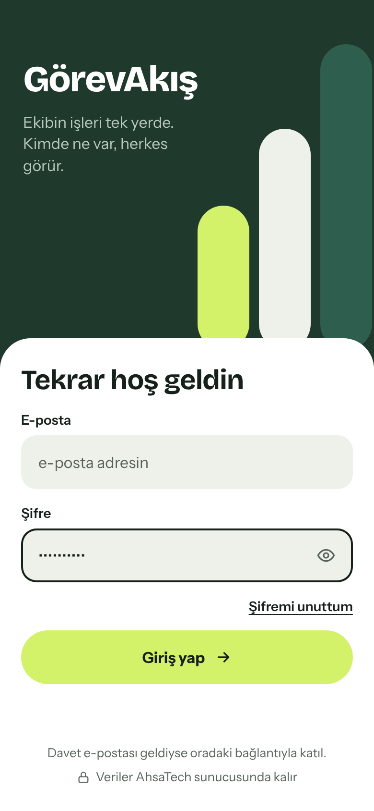<br>**01 Giriş** | 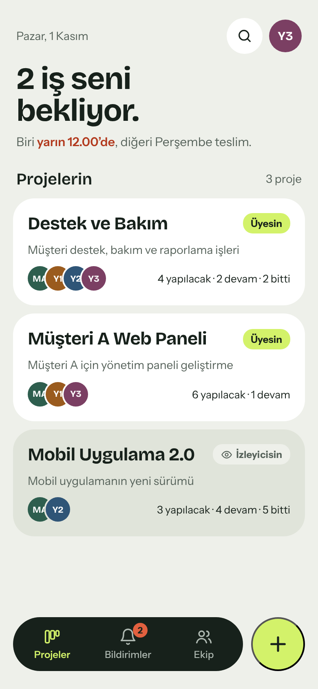<br>**02 Projeler** | 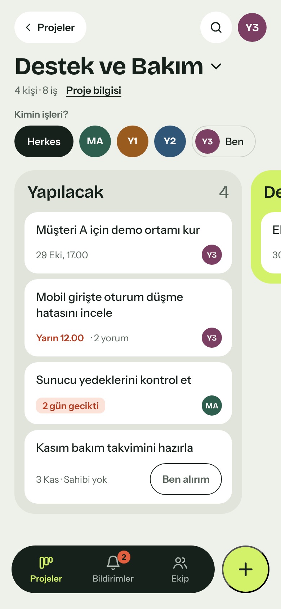<br>**03 Proje panosu** |
| 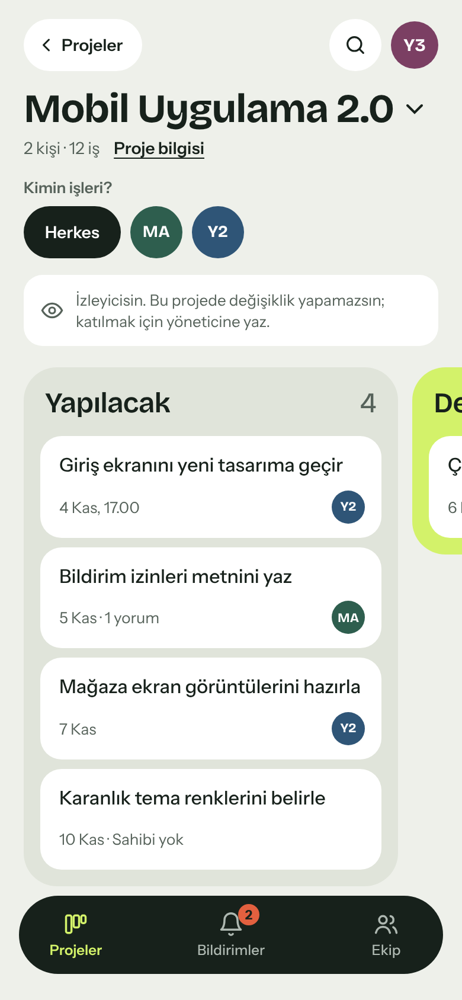<br>**04 Pano (izleyici)** | 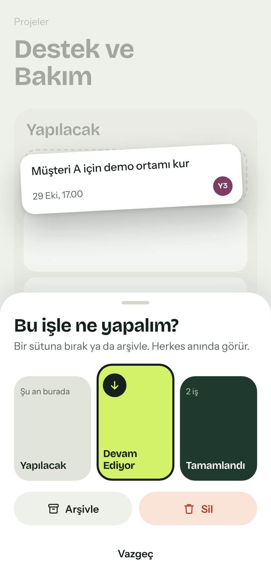<br>**05 İşi taşıma** | 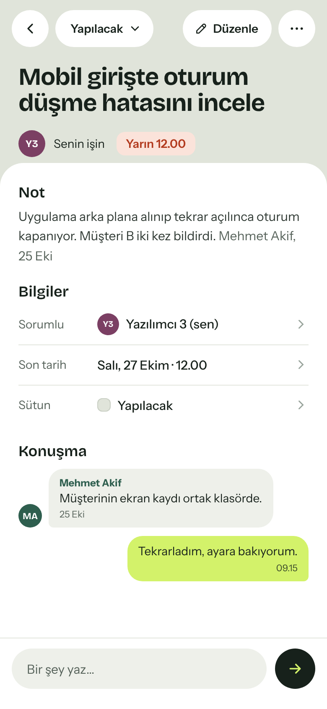<br>**06 İş detayı** |
| 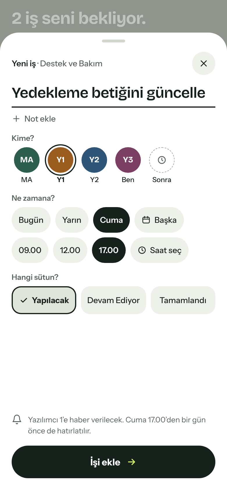<br>**07 Yeni iş** | 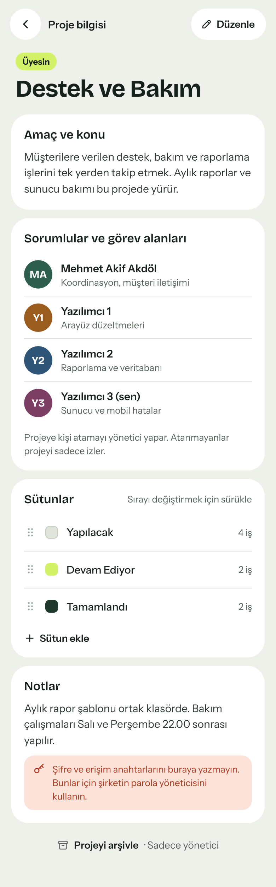<br>**08 Proje bilgisi** | 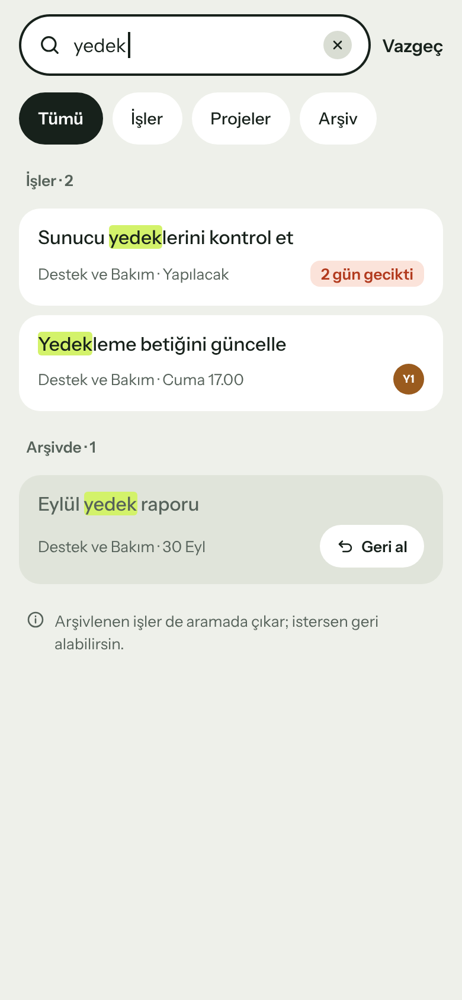<br>**09 Arama** |
| 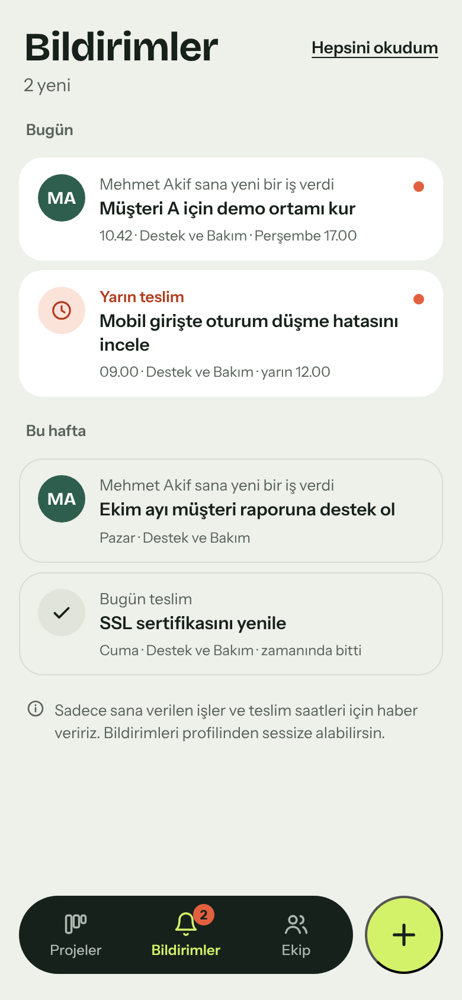<br>**10 Bildirimler** | 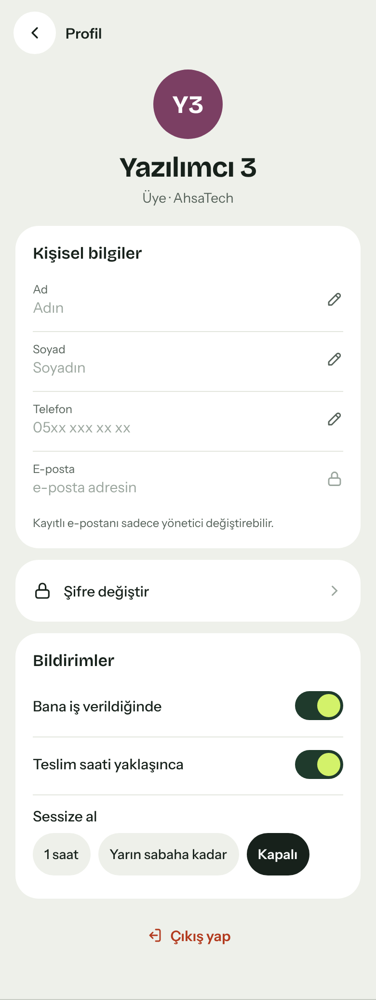<br>**11 Profil** | 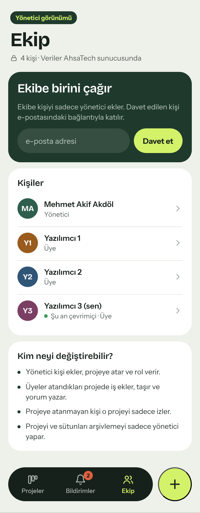<br>**12 Ekip** |

| Ekran | Dosya | Ne işe yarar |
|---|---|---|
| Giriş | `01-giris.html` | Davet e-postasıyla gelen kişi e-posta ve şifreyle girer. Kayıt ekranı yoktur; kişiyi yönetici ekler. |
| Projeler | `02-projeler.html` | Ana sayfa. Kişiyi bekleyen işler ve dahil olduğu projeler (üye ya da izleyici). |
| Proje panosu | `03-proje-panosu.html` | Projenin sütunları ve işleri. Kişiye göre filtre, sahipsiz işte "Ben alırım". |
| Pano (izleyici) | `04-proje-panosu-izleyici.html` | Projeye atanmamış kişinin görünümü. İşleri görür, değiştiremez. |
| İşi taşıma | `05-isi-tasima.html` | İş basılı tutulunca açılır. Sütuna bırakma, arşivleme ve silme. |
| İş detayı | `06-is-detayi.html` | İşin notu, sorumlusu, son tarihi, sütunu ve iş üzerindeki konuşma. |
| Yeni iş | `07-yeni-is.html` | İş adı, kime verileceği, son tarih-saat ve hangi sütuna ekleneceği. |
| Proje bilgisi | `08-proje-bilgisi.html` | Projenin amacı, sorumluları ve görev alanları, sütunlar, notlar. |
| Arama | `09-arama.html` | İşlerde, projelerde ve arşivde arama; arşivden geri alma. |
| Bildirimler | `10-bildirimler.html` | Kişiye verilen işler ve yaklaşan teslim saatleri. |
| Profil | `11-profil.html` | Ad, soyad, telefon; şifre değiştirme; bildirim ayarları. |
| Ekip | `12-ekip.html` | Yönetici görünümü. Kişi davet etme, roller ve yetkiler. |

## Roller

- **Yönetici:** kişi ekler, projeye atar, rol verir; projeyi ve sütunları arşivler.
- **Üye:** atandığı projede iş ekler, taşır, yorum yazar.
- **İzleyici:** atanmadığı projeyi sadece görür.

## Renkler

| Ad | Kod | Kullanım |
|---|---|---|
| Mürekkep | `#17211B` | Ana metin, alt menü, koyu butonlar |
| Kâğıt | `#EEF0EA` | Ekran zemini |
| Fıstık | `#D3F26A` | Vurgu, "Devam Ediyor" sütunu |
| Orman | `#1F3A2C` | "Tamamlandı" sütunu, koyu kartlar |
| Tepsi | `#E0E4DA` | "Yapılacak" sütunu |
| Domates | `#B23A1E` / `#FBE3DA` | Gecikme ve uyarılar |
| Soluk | `#56625A` | İkincil metin |

Kişi renkleri: MA `#2E5E4E`, Y1 `#9A5B1E`, Y2 `#2F5577`, Y3 `#7B3F63`.

## Yazı tipleri

- **Bricolage Grotesque:** başlıklar (Google Fonts)
- **Instrument Sans:** gövde metni (Google Fonts)

Flutter tarafında ikisi de `google_fonts` paketiyle kullanılabilir.

## Müşteri görüşmesinden sonra yapılan değişiklikler

- Proje katmanı eklendi: her kullanıcı önce projelerini görür, panolar projeye göre açılır.
- Rol katmanı eklendi: yönetici, üye ve izleyici yetkileri ayrıldı (bkz. Ekip ekranı).
- Kart içi alt görev kaldırıldı; işler tek seviyeli tutuldu.
- Projelere şifre veya erişim anahtarı yazma alanı eklenmedi; kapsam dışı bırakıldı.

Ayrıntılı liste, fizibilite raporuna eklenen değişiklik tablosundadır.
